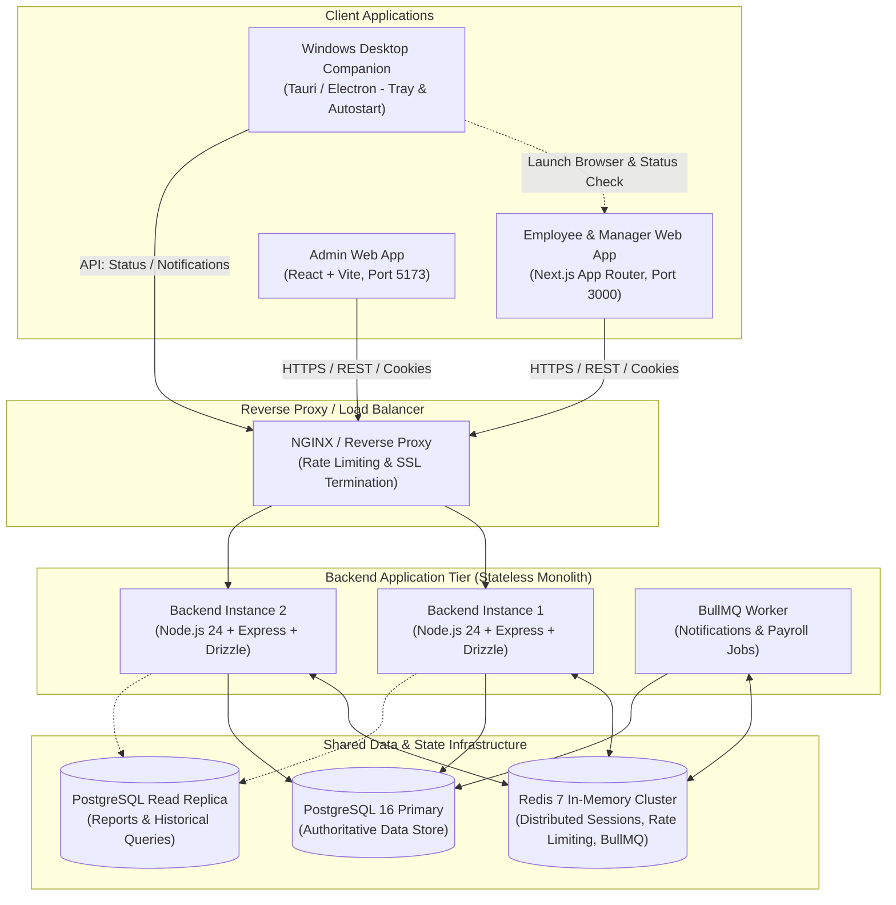
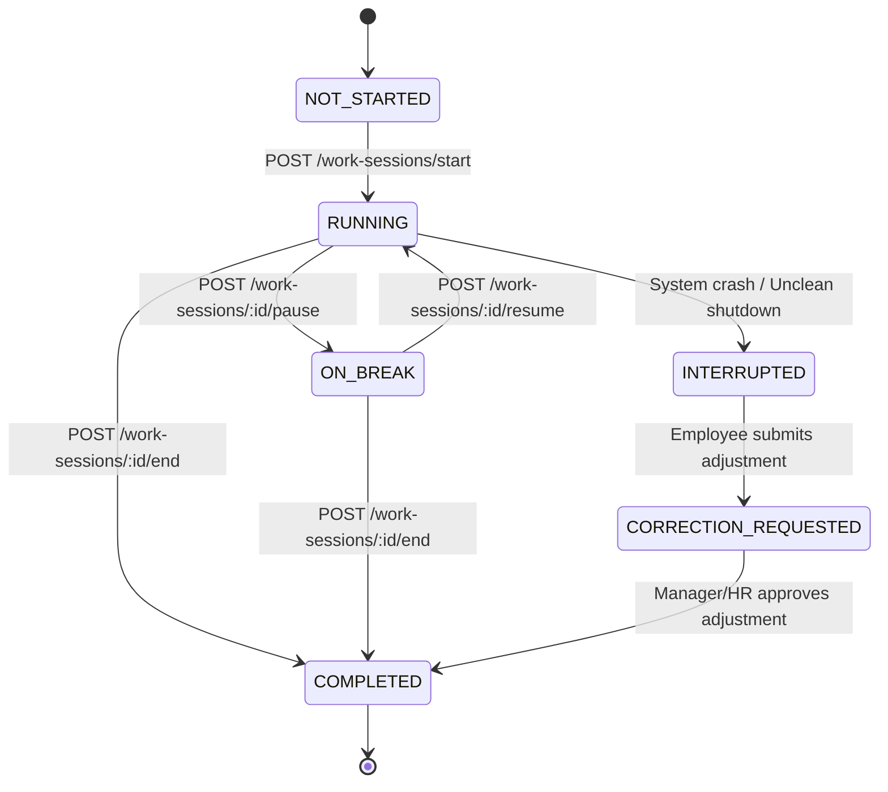

# Enterprise HRMS Portal - Architecture & System Design

## 1. High-Level Architecture Overview

The HRMS platform is structured as an enterprise-grade modular monolith backed by distributed state management (Redis) and an ACID-compliant authoritative relational database (PostgreSQL 16).

---

## 2. Component Design & Responsibilities

### 2.1 Backend Core (`/backend`)
- **Runtime**: Node.js 22+ (running on Node v24 LTS) with strict TypeScript.
- **Framework**: Express.js with modular routing, Zod schema validation, and Pino structured logging with correlation IDs (`x-request-id`).
- **ORM & Migrations**: Drizzle ORM connecting to PostgreSQL with explicit connection pooling and transaction managers.
- **Security**:
  - Argon2id for password hashing.
  - Dual-token architecture: Short-lived JWT Access Tokens (15 min) + Redis-backed rotating Refresh Tokens (7 days) with token reuse family invalidation.
  - Role-Based Access Control (RBAC) enforced per route.
  - Distributed Redis rate limiter preventing brute force and API abuse.

### 2.2 Employee & Manager Web Application (`/frontend/employee-app`)
- **Framework**: Next.js (App Router), React 19, TypeScript, Tailwind CSS, TanStack Query.
- **Features**:
  - Real-time work timer sync with server-calculated elapsed time (UTC).
  - "Start Work" prominent reminder banner upon login.
  - Break tracking (Coffee break, Lunch break, Meeting).
  - Attendance history, Leave management, Team approvals (for Managers).
  - Time-correction request workflows.

### 2.3 Admin Web Application (`/frontend/admin-app`)
- **Framework**: React + Vite, TypeScript, Tailwind CSS, React Router, TanStack Query.
- **Features**:
  - Organization settings & working hours policy.
  - Employee directory & profile lifecycle.
  - Department, designation, and reporting hierarchy management.
  - Time correction approvals & attendance reports.
  - Leave approval policies & holiday calendar.
  - Payroll preparation & payslip generation.
  - Audit logging & role permission matrices.

### 2.4 Desktop Companion (`/desktop/employee-companion`)
- **Role**: Lightweight, non-invasive Windows companion running quietly in the Windows system tray.
- **Auto-Startup**: Registers into Windows user registry (`HKCU\Software\Microsoft\Windows\CurrentVersion\Run`) or per-user Startup folder.
- **Behavior**:
  - Launches on Windows logon.
  - Checks if employee has an active work session.
  - If no timer is running, delivers a polite desktop toast: *"Good morning! Your HRMS is ready. Click to open portal and start your timer."*
  - Clicking tray icon opens default browser directly to the authenticated employee dashboard.
  - **Zero Spyware Guarantee**: Strictly NO keystroke logging, NO webcam captures, NO invasive screen recording.

---

## 3. Work-Session State Machine & Elapsed-Time Calculation

### 3.1 State Transitions

### 3.2 Elapsed Time Calculation Formula
The backend database is the sole source of truth. Elapsed work duration is calculated deterministically from UTC timestamps:
$$\text{Net Work Duration} = (\min(\text{CurrentTime}, \text{EndTime}) - \text{StartTime}) - \sum \text{ApprovedBreakDurations}$$

1. **Active Session (`RUNNING`)**:
   $$\text{Elapsed} = (\text{Now}_{\text{UTC}} - \text{StartTime}_{\text{UTC}}) - \text{TotalBreaksDuration}$$
2. **Paused Session (`ON_BREAK`)**:
   $$\text{Elapsed} = (\text{CurrentBreakStartTime}_{\text{UTC}} - \text{StartTime}_{\text{UTC}}) - \text{PreviousBreaksDuration}$$
3. **Frontend Display**: Periodic client re-render counts seconds locally using the server-provided `startTime` and accumulated break offsets, re-syncing with the backend every 60 seconds or on window focus. Browser refresh or reboot never resets elapsed time.

---

## 4. API Endpoints Specification (Core Timer & Sessions)

| Method | Endpoint | Auth | Description |
|---|---|---|---|
| `POST` | `/api/v1/auth/login` | Public | Authenticates employee, sets secure refresh cookie, returns access JWT |
| `POST` | `/api/v1/auth/refresh` | Public (Cookie) | Rotates refresh token, returns fresh access JWT |
| `POST` | `/api/v1/auth/logout` | Protected | Revokes active Redis session and clears refresh cookie |
| `GET`  | `/api/v1/work-sessions/current` | Protected | Fetches active/current session status and calculated elapsed seconds |
| `POST` | `/api/v1/work-sessions/start` | Protected | Starts work timer (idempotent, prevents duplicates) |
| `POST` | `/api/v1/work-sessions/:id/pause` | Protected | Pauses active session and initiates break record |
| `POST` | `/api/v1/work-sessions/:id/resume`| Protected | Resumes active session and closes break record |
| `POST` | `/api/v1/work-sessions/:id/end` | Protected | Ends active work session, computes total work hours |
| `GET`  | `/api/v1/work-sessions/history` | Protected | Paginated session history with break breakdowns |
| `GET`  | `/api/v1/work-sessions/summary` | Protected | Today's and this week's aggregated tracked hours |
| `POST` | `/api/v1/work-sessions/:id/correction-requests` | Protected | Submits manual correction request with rationale |
| `GET`  | `/api/v1/work-sessions/correction-requests` | Protected | Lists correction requests (employee or manager view) |
| `POST` | `/api/v1/work-sessions/correction-requests/:id/approve` | Manager/HR | Approves and reconciles work session duration |
| `POST` | `/api/v1/work-sessions/correction-requests/:id/reject` | Manager/HR | Rejects correction request with comments |

---

## 5. Security & Isolation Architecture

1. **Stateless Backend Nodes**: All session state, rate limit tokens, and job queues reside in Redis; database state is in PostgreSQL. Any backend instance can handle any incoming request.
2. **CSRF & Cookie Protection**: Refresh tokens reside in `HttpOnly`, `SameSite=Lax` (or `Strict`), `Secure` cookies. State-changing requests validate CSRF tokens when browser cookie auth is used.
3. **Database Constraints**: Partial unique index `UNIQUE(employee_id) WHERE status IN ('running', 'paused')` guarantees that no race condition can ever create overlapping active sessions.
