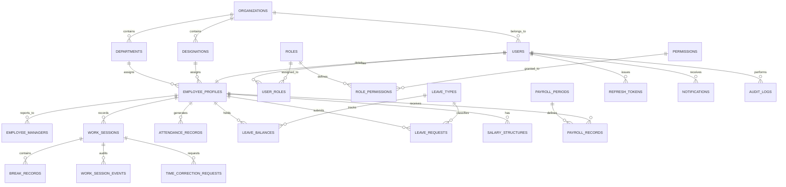

# Database Architecture & Entity Relationship Design (ERD)

Authoritative Database: **PostgreSQL 16+**  
ORM: **Drizzle ORM** with automated TypeScript migrations and typed schemas.

---

## 1. Entity Relationship Diagram (ERD)

---

## 2. Table Specifications & Schema Definitions

### 2.1 Organizations & Multi-Tenancy
- **`organizations`**
  - `id`: UUID (Primary Key, default `gen_random_uuid()`)
  - `name`: VARCHAR(255) NOT NULL
  - `code`: VARCHAR(50) UNIQUE NOT NULL
  - `time_zone`: VARCHAR(50) DEFAULT 'UTC' NOT NULL
  - `work_day_hours`: NUMERIC(4, 2) DEFAULT 8.00 NOT NULL
  - `allow_breaks`: BOOLEAN DEFAULT true
  - `max_break_minutes`: INTEGER DEFAULT 60
  - `created_at`: TIMESTAMPTZ DEFAULT NOW() NOT NULL
  - `updated_at`: TIMESTAMPTZ DEFAULT NOW() NOT NULL

### 2.2 Users & Authentication
- **`users`**
  - `id`: UUID (Primary Key)
  - `organization_id`: UUID REFERENCES organizations(id) ON DELETE CASCADE
  - `email`: VARCHAR(255) UNIQUE NOT NULL
  - `password_hash`: VARCHAR(255) NOT NULL (Argon2id)
  - `status`: VARCHAR(20) DEFAULT 'active' NOT NULL ('active', 'suspended', 'invited')
  - `failed_login_attempts`: INTEGER DEFAULT 0
  - `locked_until`: TIMESTAMPTZ NULL
  - `last_login_at`: TIMESTAMPTZ NULL
  - `created_at`: TIMESTAMPTZ DEFAULT NOW() NOT NULL
  - `updated_at`: TIMESTAMPTZ DEFAULT NOW() NOT NULL

- **`roles`** & **`permissions`**
  - `roles`: `(id, organization_id, name, slug, description, is_system_role)`
  - `permissions`: `(id, code, module, description)`
  - `role_permissions`: `(role_id, permission_id)`
  - `user_roles`: `(user_id, role_id)`

### 2.3 Employee Profiles & Hierarchy
- **`employee_profiles`**
  - `id`: UUID (Primary Key)
  - `user_id`: UUID UNIQUE REFERENCES users(id) ON DELETE CASCADE
  - `organization_id`: UUID REFERENCES organizations(id) ON DELETE CASCADE
  - `employee_code`: VARCHAR(50) NOT NULL
  - `first_name`: VARCHAR(100) NOT NULL
  - `last_name`: VARCHAR(100) NOT NULL
  - `phone`: VARCHAR(30)
  - `department_id`: UUID REFERENCES departments(id) ON DELETE SET NULL
  - `designation_id`: UUID REFERENCES designations(id) ON DELETE SET NULL
  - `joining_date`: DATE NOT NULL
  - `employment_type`: VARCHAR(30) DEFAULT 'full_time'
  - `work_location`: VARCHAR(50) DEFAULT 'office' ('office', 'remote', 'hybrid')
  - `created_at`: TIMESTAMPTZ DEFAULT NOW()
  - `updated_at`: TIMESTAMPTZ DEFAULT NOW()
  - *Constraint*: `UNIQUE(organization_id, employee_code)`

- **`employee_managers`**
  - `id`: UUID (Primary Key)
  - `employee_id`: UUID REFERENCES employee_profiles(id) ON DELETE CASCADE
  - `manager_id`: UUID REFERENCES employee_profiles(id) ON DELETE CASCADE
  - `is_primary`: BOOLEAN DEFAULT true
  - *Constraint*: `UNIQUE(employee_id, manager_id)`

### 2.4 Work Sessions & Timer (Authoritative Source of Truth)
- **`work_sessions`**
  - `id`: UUID (Primary Key)
  - `organization_id`: UUID REFERENCES organizations(id) ON DELETE CASCADE
  - `employee_id`: UUID REFERENCES employee_profiles(id) ON DELETE CASCADE
  - `status`: VARCHAR(20) NOT NULL ('running', 'paused', 'completed', 'interrupted', 'correction_requested')
  - `start_time`: TIMESTAMPTZ NOT NULL (UTC)
  - `end_time`: TIMESTAMPTZ NULL (UTC)
  - `total_break_duration_seconds`: INTEGER DEFAULT 0 NOT NULL
  - `net_work_duration_seconds`: INTEGER DEFAULT 0 NOT NULL
  - `ip_address`: VARCHAR(45)
  - `user_agent`: TEXT
  - `notes`: TEXT
  - `created_at`: TIMESTAMPTZ DEFAULT NOW()
  - `updated_at`: TIMESTAMPTZ DEFAULT NOW()
  - *Critical Constraint (Single Active Session Guard)*:
    `CREATE UNIQUE INDEX idx_unique_active_work_session ON work_sessions (employee_id) WHERE status IN ('running', 'paused');`

- **`break_records`**
  - `id`: UUID (Primary Key)
  - `work_session_id`: UUID REFERENCES work_sessions(id) ON DELETE CASCADE
  - `break_type`: VARCHAR(50) DEFAULT 'general' ('coffee', 'lunch', 'meeting', 'general')
  - `start_time`: TIMESTAMPTZ NOT NULL (UTC)
  - `end_time`: TIMESTAMPTZ NULL (UTC)
  - `duration_seconds`: INTEGER DEFAULT 0
  - `reason`: TEXT

- **`work_session_events`** (Audit Trail)
  - `id`: UUID (Primary Key)
  - `work_session_id`: UUID REFERENCES work_sessions(id) ON DELETE CASCADE
  - `event_type`: VARCHAR(50) NOT NULL ('started', 'paused', 'resumed', 'ended', 'interrupted', 'corrected')
  - `event_time`: TIMESTAMPTZ DEFAULT NOW() NOT NULL
  - `metadata`: JSONB DEFAULT '{}'
  - `actor_id`: UUID REFERENCES users(id)

- **`time_correction_requests`**
  - `id`: UUID (Primary Key)
  - `work_session_id`: UUID REFERENCES work_sessions(id) ON DELETE CASCADE
  - `employee_id`: UUID REFERENCES employee_profiles(id) ON DELETE CASCADE
  - `proposed_start_time`: TIMESTAMPTZ NOT NULL
  - `proposed_end_time`: TIMESTAMPTZ NOT NULL
  - `reason`: TEXT NOT NULL
  - `status`: VARCHAR(20) DEFAULT 'pending' ('pending', 'approved', 'rejected')
  - `reviewer_id`: UUID REFERENCES users(id) NULL
  - `reviewer_comment`: TEXT
  - `reviewed_at`: TIMESTAMPTZ NULL

### 2.5 Attendance, Leave, & Payroll
- **`attendance_records`**: Daily consolidated rollup (present, absent, half-day, late, hours_worked).
- **`leave_types`**: Configured types (Annual, Sick, Casual, Maternity, Unpaid).
- **`leave_balances`**: Available, used, and accrued quotas per employee per cycle.
- **`leave_requests`**: Requests with approval status (`pending`, `approved`, `rejected`), attachments, and manager actions.
- **`payroll_periods`** & **`payroll_records`**: Base pay, allowances, deductions, net salary, payslip generation.

### 2.6 Security, Tokens, & Audit
- **`refresh_tokens`**
  - `id`: UUID (Primary Key)
  - `user_id`: UUID REFERENCES users(id) ON DELETE CASCADE
  - `token_family`: UUID NOT NULL
  - `token_hash`: VARCHAR(255) NOT NULL
  - `is_revoked`: BOOLEAN DEFAULT false
  - `expires_at`: TIMESTAMPTZ NOT NULL
  - `created_at`: TIMESTAMPTZ DEFAULT NOW()

- **`audit_logs`**
  - `id`: UUID (Primary Key)
  - `organization_id`: UUID
  - `actor_id`: UUID REFERENCES users(id)
  - `action`: VARCHAR(100) NOT NULL
  - `entity_type`: VARCHAR(50) NOT NULL
  - `entity_id`: UUID
  - `ip_address`: VARCHAR(45)
  - `old_values`: JSONB
  - `new_values`: JSONB
  - `created_at`: TIMESTAMPTZ DEFAULT NOW()
