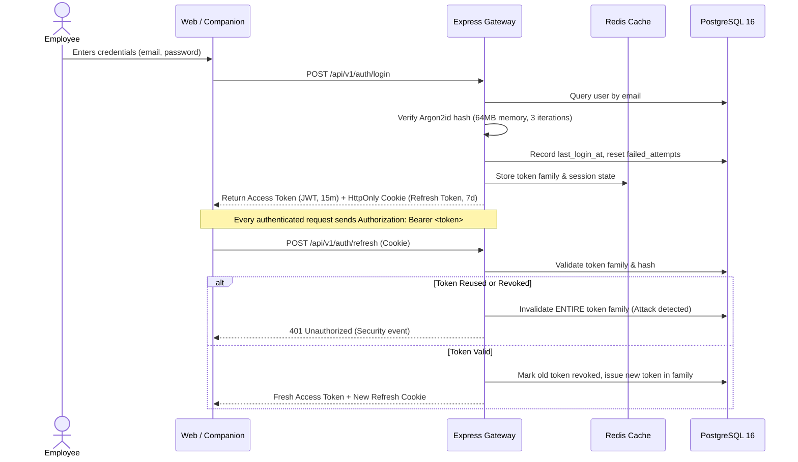

# Security Policy & Operational Architecture

## 1. Authentication & Token Architecture

The HRMS platform adopts a defense-in-depth security model:



### 1.1 Password Security
- **Algorithm**: `Argon2id` (the OWASP recommended password hashing function).
- **Parameters**: `memoryCost: 65536` (64 MB), `timeCost: 3`, `parallelism: 4`.
- **Brute Force Protection**: Account locks temporarily after repeated failed attempts; IP and account rate limits prevent automated credential stuffing.

### 1.2 Dual-Token & Token Reuse Detection
- **Access Tokens**: Short-lived (15 minutes), digitally signed using HMAC-SHA256 with a high-entropy secret.
- **Refresh Tokens**: Long-lived (7 days), stored in `HttpOnly`, `SameSite=Lax` (or `Strict`), `Secure` cookies with path restricted to `/api/v1/auth`.
- **Token Reuse Detection**: Refresh tokens are organized in cryptographic families. If an already-rotated token is presented (indicating a replay attack), the entire token family is immediately revoked, forcing re-authentication.

---

## 2. Privacy & Zero-Surveillance Compliance

The Employee Work Timer and Desktop Companion comply strictly with privacy standards:
1. **No Keystroke Logging**: The application never captures keystrokes, clipboard data, or active window titles.
2. **No Webcam or Audio Monitoring**: Zero capture of video, microphone, or ambient audio.
3. **No Screen Grabs**: The companion does not record or photograph employee screens.
4. **Explicit Worker Consent**: Windows startup never silently starts billable time. Work time is recorded **only** when the employee explicitly confirms **Start Work**.

---

## 3. Database Integrity & Concurrency Safety

1. **Single Active Session Guarantee**:
   Race conditions and duplicate timer records are prevented by a PostgreSQL partial unique index:
   ```sql
   CREATE UNIQUE INDEX "idx_unique_active_session" 
   ON "work_sessions" ("employee_id") 
   WHERE status IN ('running', 'paused');
   ```
2. **Deterministic Elapsed Time**: Work duration is calculated on the server from UTC timestamps:
   $$\text{Duration} = (\text{CurrentTime} - \text{StartTime}) - \text{TotalBreaks}$$

---

## 4. Credential Rotation Procedures

### 4.1 Rotating JWT Secrets
1. Generate new 48-byte random keys:
   ```bash
   node -e "console.log(require('crypto').randomBytes(48).toString('base64'))"
   ```
2. Update `JWT_ACCESS_SECRET` and `JWT_REFRESH_SECRET` in Kubernetes Secret or `.env`.
3. Perform a zero-downtime rolling restart. Active access tokens expire within 15 minutes; refresh cookies rotate automatically on the next renewal cycle.

### 4.2 Database Password Rotation
1. Create a secondary PostgreSQL user or update the existing password in PostgreSQL.
2. Update the connection string in `infrastructure/k8s/secrets.yaml`.
3. Apply rolling deployment: `kubectl rollout restart deployment/hrms-backend -n hrms-portal`.
